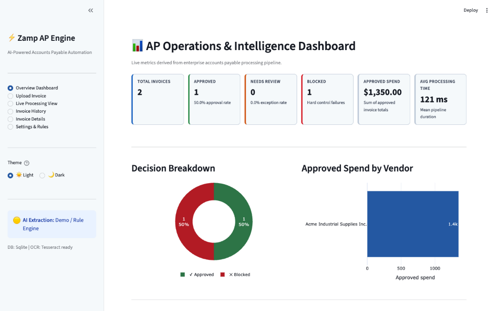
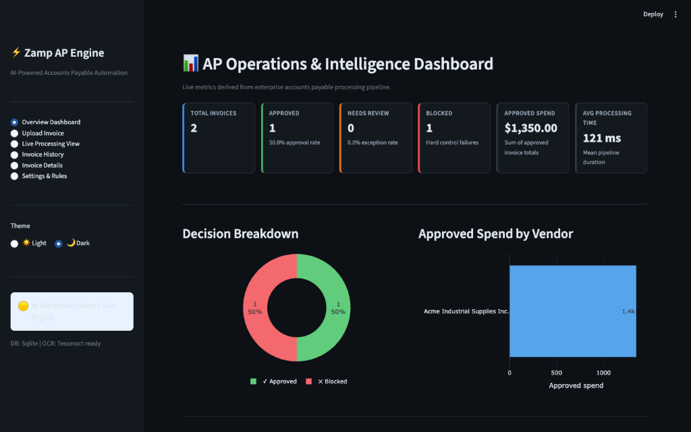
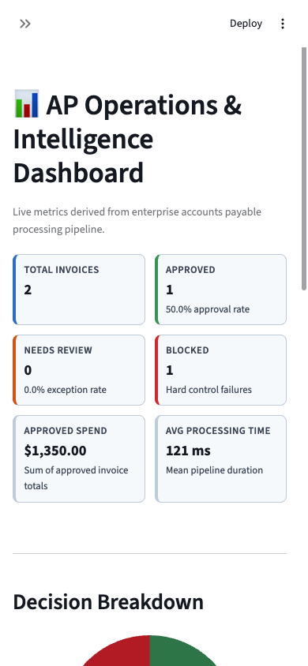
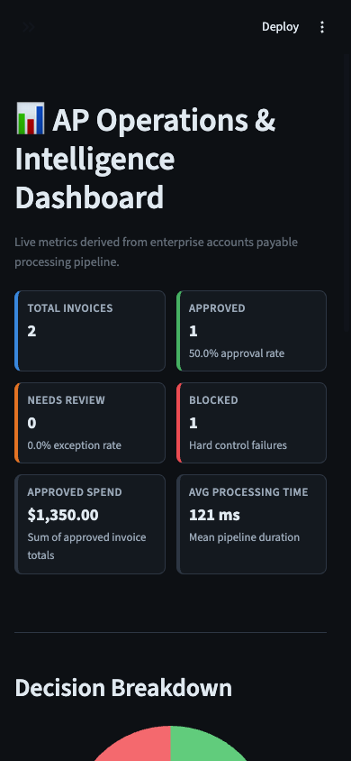
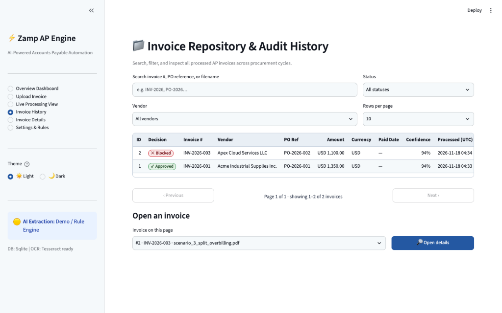
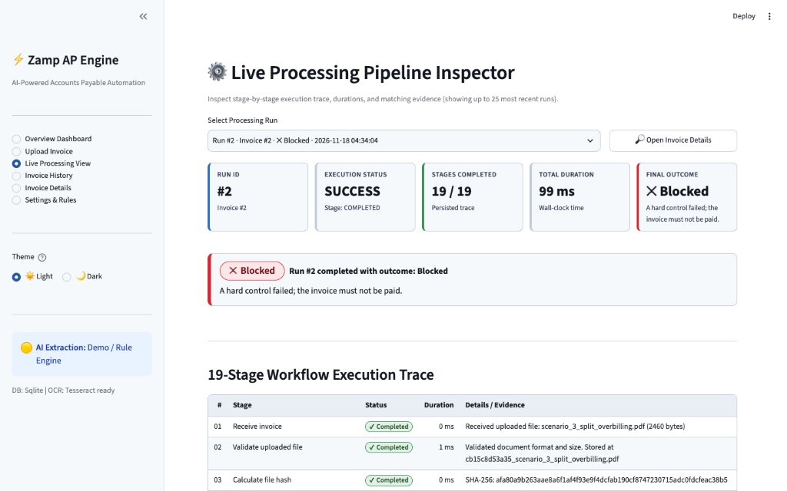
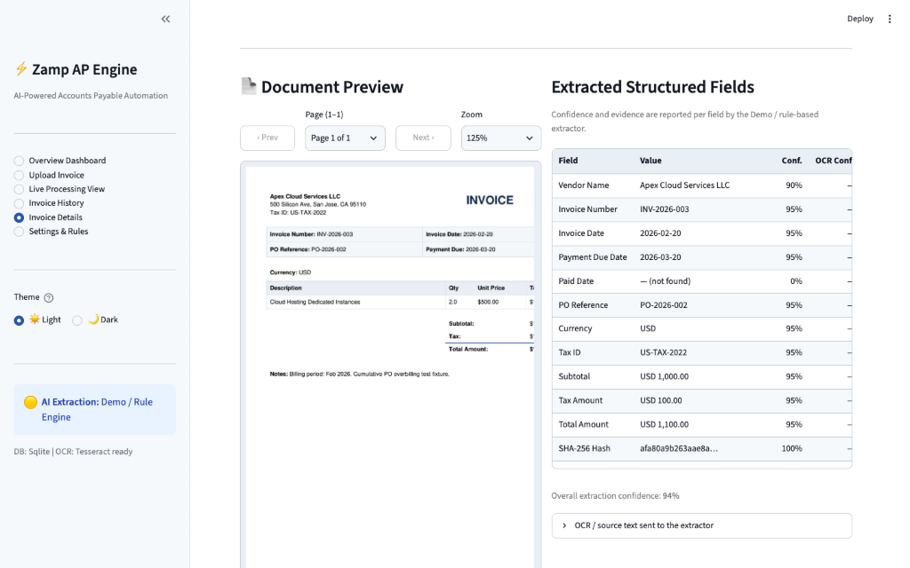

# AI-Powered Invoice Processing & AP Decision Engine

> Production-minded accounts payable (AP) automation system built for the **Zamp AI Solutions Analyst** case study.

---

## 1. Executive Summary & Core Proposition

In typical enterprise Accounts Payable (AP) workflows, staff manually process hundreds of vendor invoices: inspecting PDF scans, cross-referencing Purchase Orders (POs), checking vendor tax IDs, comparing line-item prices, verifying math and tax calculations, detecting duplicates, and assessing PO remaining balances. The process is prone to human error, expensive, and difficult to scale.

### Core Philosophy
1. **AI Interprets Unstructured Information; Deterministic Code Enforces Rules:** The Large Language Model extracts unstructured document data into a strict schema. The LLM is **never** permitted to independently approve, reject, or invent financial values.
2. **Explainable Decisions & Audit Trails:** Every validation rule emits explicit expected vs. actual values, variances, explanations, and evidence snippets.
3. **Traceable 3-Way Matching:** Links invoices against vendor registries and PO procurement balances with atomic balance tracking.
4. **Human-in-the-Loop Oversight:** Low-confidence extraction, ambiguous matches, or missing fields trigger human review (`NEEDS_REVIEW`) rather than hazardous assumptions.
5. **Multi-level Fraud & Duplicate Prevention:** Detects exact binary file duplicates, duplicate vendor invoice numbers, and near-duplicates within configurable date and amount windows.

---

## 2. System Architecture & Project Organization

The repository adheres to clean architecture principles with complete separation of concerns:

```
ap_invoice_engine/
├── .env.example               # Environment template for LLM and paths
├── requirements.txt           # Python dependency specifications
├── Dockerfile                 # Render container with Tesseract OCR
├── render.yaml                # Render Blueprint (free case-study demo defaults)
├── DEMO_WALKTHROUGH.md        # Five-minute demo narration and click path
├── README.md                  # Comprehensive architectural and run documentation
├── app/
│   ├── main.py                # Streamlit application entry point & page router
│   ├── config/
│   │   ├── settings.py        # Environment variables & system directories
│   │   ├── rules.py           # Configurable thresholds, tolerances & rule policies
│   │   ├── persistence.py     # Durable DB persistence for rules, extraction mode & FX rate
│   │   └── ui.py              # Pagination, polling, preview & test-runner constants
│   ├── core/
│   │   ├── schemas.py         # Pydantic schemas (ExtractedInvoice, RuleResult, etc.)
│   │   └── exceptions.py      # Business exceptions vs Technical failures
│   ├── ingestion/
│   │   ├── pdf_loader.py      # PyMuPDF + pdfplumber multi-page text & table extraction
│   │   ├── document_classifier.py # Classifies MACHINE_READABLE, SCANNED, HYBRID
│   │   └── ocr_engine.py      # Tesseract OCR abstraction with word-level confidence
│   ├── extraction/
│   │   ├── extractor.py       # Extraction pipeline coordinator
│   │   ├── llm_provider.py    # Groq provider & deterministic demo engine
│   │   ├── extraction_prompts.py # Strict Pydantic JSON extraction prompts
│   │   └── confidence.py      # Multi-factor & evidence-snippet OCR confidence scoring
│   ├── processing/
│   │   ├── normalizer.py      # Normalizes company names, currencies (incl. INR/₹/Rs.), dates, IDs
│   │   ├── currency.py        # Multi-currency resolution & FX conversion engine (USD ↔ INR)
│   │   ├── probabilistic_matcher.py # Multi-signal probabilistic confidence engine (Vendors, POs, Lines)
│   │   ├── vendor_matcher.py  # Probabilistic Tax ID, token-set, abbreviation & fuzzy vendor matcher
│   │   ├── po_matcher.py      # Probabilistic PO reference, amount-fit & line-similarity matcher
│   │   ├── duplicate_detector.py # 4-level duplicate detection engine
│   │   ├── financial_validator.py # Arithmetic, chronology, tax, FX conversion & PO balance validation
│   │   ├── line_item_matcher.py # Probabilistic item description match, FX price & qty variances
│   │   └── exporter.py        # In-memory Generic CSV, Xero Bills CSV, QuickBooks CSV & Audit JSON
│   ├── decision/
│   │   ├── rules_engine.py    # Aggregates and runs all AP validation rules
│   │   └── decision_service.py # Deterministic classification (APPROVED, NEEDS_REVIEW, BLOCKED)
│   ├── database/
│   │   ├── db.py              # SQLAlchemy engine, session management, SQLite/Postgres setup
│   │   ├── entities.py        # Relational models (Vendor, PO, Line Items, Invoices, Audits, AppConfig)
│   │   ├── types.py           # Timezone-aware UTCDateTime SQLAlchemy column adapter
│   │   ├── repositories.py    # Transactional repositories with atomic PO balance updates
│   │   ├── queries.py         # SQL filtering, counting & LIMIT/OFFSET pagination helpers
│   │   ├── procurement_service.py # In-app Vendor & PO onboarding with probabilistic similarity guard
│   │   └── maintenance.py     # Foreign-key-safe transactional reset service
│   ├── workflow/
│   │   ├── orchestrator.py    # 19-stage pipeline coordinator with live persisted stage events
│   │   ├── batch_runner.py    # Multi-invoice batch processor with per-document error isolation
│   │   ├── stages.py          # Canonical 19-stage pipeline definitions
│   │   └── execution_logger.py # Records execution trace, durations, and statuses
│   ├── ui/
│   │   ├── dashboard.py       # Responsive KPI grid & Plotly charts reported in Indian Rupees (INR ₹)
│   │   ├── upload.py          # Single live-stream & multi-file batch uploader + 8 scenario runners
│   │   ├── processing_view.py # Live auto-polling 19-stage execution trace inspector
│   │   ├── invoice_history.py # SQL-paginated invoice registry with Xero/QuickBooks/CSV/JSON exports
│   │   ├── invoice_details.py # Audit workbench, multi-page PDF viewer (zoom/rotate/highlight) & overrides
│   │   ├── procurement_view.py # In-app Vendor & PO management + Probabilistic Matcher Simulator
│   │   ├── settings_view.py   # Rule tolerances, extraction mode, USD→INR FX rate & local test runner
│   │   ├── theme.py           # Session-scoped Light/Dark theme tokens & Plotly styling
│   │   ├── presentation.py    # Accessible symbol+text status badges, KPI grid & HTML tables
│   │   ├── components.py      # Reusable Streamlit pagination & status banner components
│   │   ├── document_preview.py # Bounded single-page PDF/raster preview, rotation & text highlighting
│   │   └── run_trace.py       # Resilient stage trace parser & active/stale polling controller
│   └── utils/
│       ├── file_storage.py    # Secure PDF/image storage and path sanitization
│       ├── hashing.py         # SHA-256 calculation utilities
│       ├── time.py            # Timezone-aware UTC datetime helpers
│       └── logging.py         # Standardized application logging
├── data/
│   ├── uploads/               # Secure uploaded file storage
│   └── sample_data/           # Synthetic test PDF/image fixtures
├── docs/
│   └── screenshots/           # Verified desktop & mobile Light/Dark UI screenshots
├── scripts/
│   ├── seed_database.py       # Seeds 5 vendors, 10 POs, and line items
│   └── generate_test_invoices.py # Generates 8 PDF/image scenario fixtures
└── tests/
    ├── conftest.py            # Isolated in-memory SQLite fixtures
    ├── fixtures/              # Multi-page PDF & low-resolution raster test fixtures
    ├── test_foundations.py    # UTC timestamps, DB reset safety, persisted rules & credential gating
    ├── test_db_migrations.py  # Non-destructive schema migration tests
    ├── test_ingestion.py      # PDF classification, multi-page table extraction, OCR abstraction
    ├── test_ocr_confidence.py # Evidence-snippet OCR word confidence scoring
    ├── test_extraction.py     # Schema validation, Groq structured output, retry & confidence scoring
    ├── test_matching.py       # Vendor, PO, and line-item matching
    ├── test_duplicates.py     # 4-level duplicate detection
    ├── test_financial_validation.py # Math, tax, currency, and PO balance overbilling
    ├── test_decisions.py      # Decision classification & explainability
    ├── test_safety_and_progress.py # Atomic PO reservation, live stage persistence & failure handling
    ├── test_workflow.py       # End-to-end orchestration, atomic updates, human overrides
    └── test_phase2_ui_and_queries.py # SQL pagination, live trace, PDF preview, FX, probabilistic matcher & exports
```

---

## 3. The 19-Stage Workflow Pipeline

The central `WorkflowOrchestrator` coordinates the end-to-end lifecycle of every invoice:

| Stage # | Stage Name | Description |
|---|---|---|
| **1** | **Receive invoice** | Validates presence of file payload or filesystem reference. |
| **2** | **Validate uploaded file** | Inspects magic `%PDF` header bytes, file extension, and enforces size limit (<= 20MB). |
| **3** | **Calculate file hash** | Computes SHA-256 binary hash for persistent identification. |
| **4** | **Check for exact duplicate** | Level 1 duplicate check: blocks if an identical file hash has already been processed. |
| **5** | **Extract document text** | Extracts digital PDF text or OCR text from raster invoice images. |
| **6** | **Run OCR when necessary** | Evaluates document type. Engages OCR only when text density is insufficient (scanned/hybrid). |
| **7** | **Extract structured info** | Invokes LLM provider with structured schema (or deterministic demo engine in offline mode). |
| **8** | **Validate extracted schema** | Enforces strict Pydantic models. Missing values remain `null`; never invented. |
| **9** | **Normalise extracted fields** | Standardizes vendor corporate suffixes, currencies (ISO 4217), dates (ISO 8601), and IDs. |
| **10** | **Match vendor** | Hierarchical matching: Exact Tax ID → Exact Normalized Name → Fuzzy similarity scoring. |
| **11** | **Match purchase order** | Exact PO reference verification → Vendor cross-check → Candidate similarity ranking. |
| **12** | **Detect duplicate invoices** | Level 2–4 checks: Vendor + Invoice Number match, and Near-Duplicates (similar amount within 7 days). |
| **13** | **Match line items** | Compares invoice line items against PO lines for description similarity, price variances, and quantities. |
| **14** | **Run financial validation** | Verifies line item math (`qty * price`), subtotal sum, tax calculation, and currency alignment. |
| **15** | **Run PO balance validation** | Calculates `remaining_balance = total_amount - billed_amount`. Flags or blocks overbilling. |
| **16** | **Generate final decision** | Decision engine deterministically maps rule results to `APPROVED`, `NEEDS_REVIEW`, or `BLOCKED`. |
| **17** | **Save all results** | Persists Invoice, Line Items, and Validation Result entities to SQLite. |
| **18** | **Update invoice & PO records** | Rechecks for duplicates, then atomically reserves an open PO balance before persisting an `APPROVED` outcome. |
| **19** | **Generate final audit report** | Emits an immutable `AuditLog` entry documenting the run, decision, actor, and timestamp. |

---

## 4. Installation & Environment Setup

### Prerequisites
- Python 3.11 (pinned via `runtime.txt`; tested on 3.11–3.13).
- (Optional) Tesseract OCR on the host (`brew install tesseract` on macOS, `apt-get install tesseract-ocr` on Debian/Ubuntu). If OCR is needed but unavailable, scanned pages are routed to human review instead of being treated as extracted text. On Streamlit Community Cloud, Tesseract is installed via `packages.txt`.

### Step 1: Clone the Repository
```bash
git clone https://github.com/gargarnav0708/ap_invoice_engine
cd ap_invoice_engine
```

### Step 2: Install Dependencies

In VS Code, open the repository folder, then create and select a project-local
virtual environment:

```bash
python3 -m venv .venv
# macOS/Linux
source .venv/bin/activate
# Windows PowerShell: .venv\Scripts\Activate.ps1

python3 -m pip install --upgrade pip
python3 -m pip install -r requirements-dev.txt
```

`requirements-dev.txt` includes the runtime packages plus the static checker.
For a deployment-only installation, use `requirements.txt`.

### Step 3: Configure Environment Variables
Copy the template configuration:
```bash
cp .env.example .env
```
Inside `.env`:
```env
# Optional: Provide Groq credentials for live LLM extraction.
# If left blank, the application automatically runs in Demo / Offline Mode using
# the deterministic rule engine (does not hallucinate or make network requests).
LLM_API_KEY=
LLM_BASE_URL=https://api.groq.com/openai/v1
LLM_MODEL=openai/gpt-oss-20b
LLM_MAX_COMPLETION_TOKENS=8192
LLM_RETRY_MAX_COMPLETION_TOKENS=16384
LLM_REASONING_EFFORT=low
EXTRACTION_MODE=live

# Database Configuration
DATABASE_URL=sqlite:///data/ap_invoices.db

# Storage Directories
STORAGE_DIR=data/uploads
SAMPLE_DATA_DIR=data/sample_data

# OCR Engine
OCR_ENABLED=true
TESSERACT_CMD=
```

### Demo versus live extraction

- `demo` is the safe default. It uses the deterministic offline extractor and
  makes no LLM network request.
- `live` uses Groq's OpenAI-compatible API. It is available only
  when `LLM_API_KEY` is set in `.env`, Streamlit secrets, or the deployment
  environment.
- The active mode can be changed under **Settings & Rules → Extraction Mode**.
  The choice is persisted in the database, but API keys are never accepted,
  displayed, overwritten, or stored by the UI. If live mode loses its runtime
  credential, the application safely falls back to demo mode.
- Live structured extraction explicitly allows 8,192 completion tokens and retries once at
  16,384 when Groq reports truncation or returns `finish_reason=length`. GPT-OSS uses low
  reasoning effort for this extraction-only task; adjust the token limits with the
  `LLM_MAX_COMPLETION_TOKENS` and `LLM_RETRY_MAX_COMPLETION_TOKENS` environment variables.

---

## 5. Database Initialization & Synthetic Fixtures

The app **self-seeds on first launch**: on startup it creates the tables, seeds
5 vendors and 10 POs if the database is empty, and generates the 8 benchmark
invoice PDF/image fixtures if they are missing. No manual step is required for a fresh deploy.

To seed manually (e.g. for CLI testing):

```bash
# 1. Initialize tables and seed procurement records
PYTHONPATH=. python3 scripts/seed_database.py

# 2. Generate the 8 benchmark PDF/image fixtures
PYTHONPATH=. python3 scripts/generate_test_invoices.py
```

---

## 6. Running the Application (VS Code & Terminal)

Launch the Streamlit web dashboard directly from the integrated VS Code terminal (the entry point automatically adds the repository root to `sys.path`):

```bash
# Activate virtual environment
source .venv/bin/activate

# Start the Streamlit application
streamlit run app/main.py
```
Open your browser to: **`http://localhost:8501`**

### Phase 2 UI/UX & Operational Features
- **Responsive Layout (`1440px` desktop, `768px` tablet, `390px` mobile):** Six KPI cards use an auto-fit CSS grid (`ap-kpi-grid`) that wraps cleanly from 6 across on wide screens to 3 or 2 across on narrow viewports without clipping or horizontal overflow. Tables sit inside keyboard-focusable horizontal scroll regions (`ap-table-wrap`).
- **Session-Scoped Light / Dark Theme Selector:** Toggle between `☀️ Light` and `🌙 Dark` in the sidebar. The preference is stored strictly in `st.session_state` per browser session; `.streamlit/config.toml` remains the read-only startup default and is never rewritten at runtime.
- **Database-Backed Pagination (`LIMIT` / `OFFSET`):** Both **Invoice History** and the **Invoice Details** selector filter and count in SQL (`app/database/queries.py`) with deterministic `created_at DESC, id DESC` ordering, configurable page sizes (`10`, `25`, `50`), Previous/Next controls, and automatic page reset when search/filter criteria change.
- **Live Persisted Processing Timeline:** **Live Processing View** bounds the run selector to the 25 most recent runs, queries the selected run directly by primary key, and uses `st.fragment(run_every=2.0)` to auto-refresh `RUNNING` runs until they reach `SUCCESS` or `FAILED` (or pause if stale beyond 15 minutes). Malformed or missing stage JSON degrades gracefully without crashing.
- **Bounded Document Preview with Page, Zoom, Rotation & Visual Highlighting:** **Invoice Details** renders only the selected PDF page at a bounded DPI (`50%–200%` zoom, `0°/90°/180°/270°` rotation), preserves the selected page while inspecting the same invoice, clamps/resets page state when switching invoices, and supports optional translucent bounding-box highlighting of extracted field values and custom search text directly on the PDF page. Raster images render without PDF-only page controls, and missing files clearly explain Render's temporary `/tmp` storage behavior.
- **Accessible Status Presentation:** `APPROVED` (`✓`), `NEEDS_REVIEW` (`!`), `BLOCKED` (`✕`), and `FAILED` (`✕ Failed · needs review`) always combine symbol + text label + semantic tone across the dashboard, history, upload decision card, live processing view, and invoice details. Failed runs are always presented as failed and needing review, never as in-progress.
- **Batch Multi-Invoice Upload & Accounting Exports:** Upload a single file for the 19-stage live stream, or select multiple files in **Upload Invoice** to run a batch job with per-document error isolation (`app/workflow/batch_runner.py`). Export filtered pages or individual audited invoices to **Generic Audit CSV**, **Xero Bills CSV**, **QuickBooks Online CSV**, or **Audit JSON** (`app/processing/exporter.py`).
- **In-App Vendors & Purchase Orders Management (`Vendors & Purchase Orders`):** Register new vendors (with Tax ID / GSTIN, country, address, bank account, and approval status), toggle vendor approval status, and create new Purchase Orders with multi-row line items in **Indian Rupees (`INR ₹`)**, **US Dollars (`USD $`)**, or any supported currency (`app/ui/procurement_view.py`).
- **Probabilistic Multi-Signal Vendor & PO Confidence Engine (`app/processing/probabilistic_matcher.py`):** Matches differently formatted vendor names (expanding abbreviations like `Ind.` → `Industrial`, `Supp.` → `Supplies`, stripping honorifics like `M/s`, and combining order-invariant token Dice, token containment, character similarity, and OCR-canonical Tax ID/GSTIN matching) and differently formatted PO references (`P.O. #2026/01` ↔ `PO-2026-001`, leading-zero normalization, OCR look-alike canonicalization, FX-converted amount closeness, and line-item similarity). Includes an interactive **🎯 Probabilistic Matcher & Confidence Simulator** tab inside **Vendors & Purchase Orders**.
- **Indian Rupee (`INR ₹`) Reporting & Cross-Currency FX Conversion (`app/processing/currency.py`):** Recognizes `INR`, `₹`, `Rs.`, `Rupees`, and `GST`/`IGST`/`CGST` labels natively, automatically confirms `$` against matched PO/vendor context, converts approved spend across currencies into **`INR (₹)`** on the **Overview Dashboard**, displays native + `INR` equivalents across views, and converts cross-currency invoices (`USD` ↔ `INR`) against matched Purchase Orders at a configurable `USD → INR` exchange rate in **Settings & Rules**.
- **Local-Only Developer Test Runner:** In `development` and `test` environments (when not running on Render or cloud platforms), **Settings & Rules** exposes a guarded `🧪 Run Automated Test Suite (pytest -q)` button that runs `[sys.executable, "-m", "pytest", "-q"]` with `shell=False`, a timeout, and capped output.

### Verified UI Screenshots

| View & Viewport | Screenshot |
|---|---|
| **Overview Dashboard (`1440px`, Light)** |  |
| **Overview Dashboard (`1440px`, Dark)** |  |
| **Overview Dashboard (`390px` Mobile, Light & Dark)** |   |
| **Invoice History & SQL Pagination (`1440px`, Light)** |  |
| **Live Processing View (`1440px`, Light)** |  |
| **Invoice Details & PDF Preview (`1440px`, Light)** |  |

Upload a PDF or PNG, JPEG, TIFF, or BMP invoice image (or use the **Quick Test Scenarios** tab). Images are OCR'd through the configured OCR engine and then follow the same extraction, validation, and review process as PDFs. Each run streams
its 19 stages live as they execute and ends with a reasoned **decision card**
(status, the reasons behind it, and the recommended next action).
Stage transitions are also saved to the run history as they happen, so an
interrupted run retains its last visible stage.

For a clean demo, start with a fresh disposable database. The clean invoice
consumes PO balance, so rerunning it against a database with previous runs can
correctly produce a different decision. Do not reset a database containing
records you need to keep. The Settings reset control requires confirmation and
is disabled unless `APP_ENV` is `development` or `test`.

Editable rule thresholds and the extraction-mode choice are stored in the
configured database, so they survive application restarts (subject to the
database retention limits of the selected Render plan).

### Recovery notes

- **Scenario returns a different decision:** invoice history and PO balances are stateful. Use a fresh disposable database or choose a scenario whose expected preconditions are met; Scenario 7 requires Scenario 1 first.
- **No scenario fixtures appear:** the app generates fixtures at startup. Check the application logs for a fixture-generation error and verify `SAMPLE_DATA_DIR` is writable.
- **Scanned invoice reports OCR unavailable:** verify `tesseract --version` in the same runtime as Streamlit. On Render, the Docker image installs Tesseract; locally, set `TESSERACT_CMD` to its executable path if it is not on `PATH`.
- **Render reports unhealthy:** inspect the service logs for a database connection failure, then confirm the service's `DATABASE_URL` references the Blueprint Postgres service. Render checks `/_stcore/health`.
- **An uploaded preview is missing after a Render restart:** the free Blueprint uses temporary file storage. Re-upload the document for the demo, or use a paid persistent disk for durable files.

### Deploy on Render

The repository includes `render.yaml` and a Dockerfile. The container installs
Tesseract and runs Streamlit on Render's assigned `$PORT`; the Blueprint connects
the app to Render Postgres using psycopg 3.

1. Push the repository to GitHub.
2. In Render, choose **New → Blueprint**, connect this repository, and review
   `render.yaml` before creating the services.
3. The default Blueprint uses a **Free web service** and **Free Postgres** to
   avoid surprise charges. Render's Free Postgres expires 30 days after creation,
   and the free web service has an ephemeral filesystem. Uploaded invoice files
   are therefore temporary and may disappear after a restart or deploy. These
   settings are for a case-study demo; do not upload real or sensitive invoices.
4. To persist uploaded files, move the web service to a paid plan and attach a
   persistent disk mounted at `/var/data`, then set `STORAGE_DIR=/var/data/uploads`.
   For longer-lived database retention, upgrade Postgres to a paid plan and set
   backups/retention according to your requirements.
5. For optional live extraction, add `LLM_API_KEY`, `LLM_BASE_URL`, and
   `LLM_MODEL`    under the Render service's environment settings, then select Live
   in the Settings UI (or set `EXTRACTION_MODE=live`). Without an API key, the
   demo extractor remains active. Set `TESSERACT_CMD` only if the
   container's default `tesseract` executable is unavailable.

The service seeds demo procurement records and fixture files on first launch.
Render's health check uses Streamlit's `/_stcore/health` endpoint. Check the
deploy logs if startup fails; the container logs include database connection,
seed, and OCR initialization errors. A fresh deploy does not migrate or import
your local SQLite database.

### Deploy on Streamlit Community Cloud

1. Push this repo to GitHub and point [share.streamlit.io](https://share.streamlit.io) at `app/main.py`.
2. `packages.txt` installs Tesseract OCR and `runtime.txt` pins Python 3.11 automatically.
3. (Optional) For live LLM extraction, open **App → Settings → Secrets** and paste the contents of `.streamlit/secrets.toml.example`, filling in `LLM_API_KEY`. Left blank, the app runs the deterministic demo extractor with no network calls.
4. The database and sample fixtures are created automatically on first load.

---

## 7. Automated Test Suite

Run the full automated unit and integration test suite:

```bash
PYTHONPATH=. python3 -m pytest -v
python3 -m mypy
```

The tests cover:
- PDF document classification & OCR abstraction
- Multi-page text/table extraction, per-page evidence, and unreadable-page fallback
- Timezone-aware UTC creation and legacy database timestamp loading
- Foreign-key-safe local database reset
- Rule threshold validation and persistence across database sessions
- Demo/live extraction-mode credential gating
- Schema validation & missing-field null handling
- Exact and fuzzy vendor matching
- PO matching & vendor cross-checks
- 4-level duplicate detection
- Financial arithmetic, tax checks, rounding tolerances, and PO balance overbilling
- Deterministic decision classification
- End-to-end workflow execution, atomic PO deductions, and human reviewer overrides
- Raster image validation and OCR fallback to human review
- Persisted live stage updates, conditional PO reservations, and corrected approval reconciliation
- SQL-backed invoice pagination, filter counts, page boundary clamping, and deterministic timestamp tie-breaking
- Live Processing View trace parsing, malformed JSON resilience, and terminal vs. active polling behavior
- Bounded single-page PDF preview rendering, zoom-to-DPI capping, rotation, on-page text highlighting, and missing-file explanations
- Multi-format accounting exports (Generic CSV, Xero Bills CSV, QuickBooks Online CSV, Audit JSON), batch upload error isolation, and chronological due-date validation (`RULE_DUE_DATE_CHRONOLOGY`)

---

## 8. Demonstrating the 8 Core Scenarios

The system can be tested immediately using the 1-click scenario buttons in the UI under **Upload Invoice > Quick Test Scenarios (1-Click)** or programmatically via the command line:

### Scenario 1: Clean Invoice
- **Document:** `scenario_1_clean_invoice.pdf`
- **Vendor:** Acme Industrial Supplies Inc. (Approved, Tax ID: `US-TAX-1011`)
- **PO:** `PO-2026-001` (Active, Remaining Balance: $2,500.00)
- **Line Items:** 20 Helmets @ $50.00 ($1,000.00) + 10 Gloves @ $25.00 ($250.00). Subtotal: $1,250.00, Tax: $100.00, Total: $1,350.00.
- **Outcome:** `APPROVED`
- **Audit Action:** PO remaining balance atomically decremented from $2,500.00 to $1,150.00.

### Scenario 2: Duplicate Invoice
- **Document:** `scenario_2_duplicate_invoice.pdf` (exact re-submission of Invoice 1)
- **Outcome:** `BLOCKED`
- **Evidence:** Level 1 binary SHA-256 file duplicate detected pointing to original Invoice ID #1.

### Scenario 3: Split PO Overbilling
- **Document:** `scenario_3_split_overbilling.pdf`
- **Vendor:** Apex Cloud Services LLC
- **PO:** `PO-2026-002` (Total: $5,000.00, Previously Billed: $4,500.00, Remaining Balance: $500.00)
- **Invoice Amount:** $1,100.00 ($1,000.00 + $100.00 tax)
- **Outcome:** `BLOCKED`
- **Evidence:** Invoice total ($1,100.00) exceeds available PO balance ($500.00) by $600.00.

### Scenario 4: Poor-Quality / Incomplete Invoice
- **Document:** `scenario_4_incomplete_invoice.pdf`
- **Issue:** Missing formal invoice number, missing PO reference, illegible tax.
- **Outcome:** `NEEDS_REVIEW`
- **Evidence:** Soft validation failure flagged for missing critical fields and unlinked PO. Sent to human reviewer workbench for inspection and override.

### Scenario 5: Low-Quality Scan
- **Document:** `scenario_5_scanned_low_quality.png`
- **Issue:** Blurred, low-resolution raster scan of an incomplete invoice.
- **Outcome:** `NEEDS_REVIEW`
- **Evidence:** Exercises preprocessed image OCR; low OCR confidence, missing scanned line items,
  or ambiguous currency routes the invoice to a reviewer. A bare `$` is not assumed to mean USD.

### OCR and currency safeguards
- Small raster images are cropped, deskewed, contrast-normalized, upscaled, and read with Tesseract
  page segmentation modes 6 and 11. The stronger word-confidence result is retained with the run.
- OCR word confidence below 55% triggers human review. Scanned invoices without extracted line items
  also require review; totals are checked against extracted line items plus tax before approval.
- Currency is only normalized when explicitly identified. Ambiguous symbols such as `$` stay
  unconfirmed until a reviewer checks the vendor or PO evidence. Manual currency confirmation is
  recorded in the audit trail.
- Invoice date, due date, and paid date are separate fields. Existing SQLite/Postgres databases gain
  the nullable `paid_date` column automatically at startup.

### Scenario 6: Ambiguous PO
- **Document:** `scenario_6_ambiguous_po.pdf`
- **Issue:** Known vendor but no PO reference, leaving multiple plausible orders.
- **Outcome:** `NEEDS_REVIEW`
- **Evidence:** The PO matcher does not silently choose among candidates.

### Scenario 7: Changed-PDF Near Duplicate
- **Document:** `scenario_7_changed_pdf_near_duplicate.pdf`
- **Issue:** Different file and invoice number, same vendor and amount within seven days of Scenario 1.
- **Outcome:** `NEEDS_REVIEW`
- **Evidence:** Level 4 near-duplicate detection flags the candidate for comparison.
- **Run order:** Process Scenario 1 first; Scenario 7 uses it as its comparison record.

### Scenario 8: Small Tolerance Variance
- **Document:** `scenario_8_small_tolerance_variance.pdf`
- **Issue:** $0.04 total arithmetic variance and 0.5% unit-price variance.
- **Outcome:** `APPROVED` when run against a fresh database and open PO balance.
- **Evidence:** Both differences sit within the configured tolerances.

---

## 9. Human Review & Manual Overrides

When an invoice receives `NEEDS_REVIEW` or `BLOCKED`, a reviewer can audit the invoice:
1. Navigate to **Invoice Details**.
2. Inspect the PDF page preview, extracted fields, matched vendor, matched PO, and rule check logs.
3. Optionally correct the vendor, PO, invoice number, or total. A PO must belong to the selected vendor.
4. Submit an override decision (`APPROVED`, `NEEDS_REVIEW`, `BLOCKED`) with a **mandatory reason** and reviewer label.
5. The system preserves the automated extraction payload, records the reviewer's before/after values and timestamp, and atomically adjusts the PO balance if approval changes the reservation. Repeating the same review action is idempotent and does not create another audit event.

The reviewer label is user-entered for the case-study demo; it is not authenticated identity. Add login and role checks before using this workflow with real AP operators.

---

## 10. Limitations & Future Roadmap

### Current Scope & Demo Boundaries
- **Local development:** Uses thread-safe SQLite with PRAGMA foreign keys enabled. Render demo uses managed Postgres.
- **Demo identity and retention:** Reviewer names are self-entered, and Render free storage is temporary. Do not use production invoices.
- **Schema management:** Tables are created automatically, but the project does
  not yet include a migration framework. The UTC column adapter deliberately
  preserves the existing physical timestamp schema.
- **Payment Execution:** Intentionally stops at the approval/escalation decision; does not execute direct banking payments.

### Next Architecture Steps
1. Add authenticated users and role-based approval limits, with immutable reviewer identity from the auth provider.
2. Add database migrations and a paid managed database with backups, retention, and restore drills.
3. Move invoice binaries to controlled object storage with encryption and retention policies.
4. Add tenant boundaries, operational monitoring, and ERP integrations behind provider interfaces.
5. Consider multi-currency FX rates and advanced multi-page table stitching after the core operational controls are in place.
